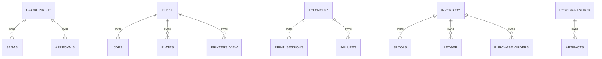

# 03 · State management

## 1. Where state lives

| Kind of state | Store | Owner | Durability | Example |
|---|---|---|---|---|
| Business records | **PostgreSQL**, one schema per agent | that agent | durable, backed up | orders/sagas, jobs, plates, spools, ledger |
| Outgoing messages not yet published | `messaging.outbox` | the producing agent (`producer` column) | durable | `evt.fleet.plate.scheduled` waiting for the relay |
| Messages already processed | `messaging.inbox` | the consuming agent (`consumer` column) | durable (prune after 30 days) | de-duplication |
| Workflow progress | `coordinator.sagas` (+ `saga_history`) | Coordinator | durable | order `ord-1a2b` is `PRINTING`, unit 2 on attempt 2 |
| Message history | JetStream EVENTS (30 days) / COMMANDS / DLQ | bus | durable | replay or debug an order end to end |
| Live, fast-changing, overwrite-only | **NATS KV** | writer named per bucket | in NATS (file) / TTL | `printer_status`, `heartbeats` (30 s TTL), `leases` (60 s TTL) |
| Live telemetry series | JetStream TELEMETRY | Telemetry | memory, 1 hour | temperature charts |
| In-process hot state | agent memory | Telemetry | lost on restart (rebuilt from the next sample) | detector windows, last state per printer |
| Files | artifact volume (→ S3/MinIO, ADR-0006) | Personalization | durable, backed up | `.scad`, `.stl`, `.gcode` |
| Embeddings | pgvector in `social` / `trend` | LLM agents | durable | lead de-duplication |

**Rule: no agent reads or writes another agent's schema.** If Fleet needs to know about spool levels, it asks Inventory
(`qry.inventory.availability`) or listens for its events. Production enforces this with a Postgres role per agent
(`GRANT USAGE ON SCHEMA fleet, messaging TO fleet_agent`). In development all agents share one role for convenience.

Ownership map:



## 2. Consistency model

* **Within an agent: strong.** One handler invocation = one Postgres transaction covering the inbox claim, business writes and outbox
  inserts (`agents/base.py`).
* **Across agents: eventual, causally ordered per workflow.** An order's state at the Coordinator lags reality by the relay interval plus
  delivery time, typically under 300 ms on one host.
* **Each agent keeps its own read model of others' facts.** Fleet keeps `fleet.printers.online/busy` from Telemetry's events instead of
  reading Telemetry's tables. That copy can be briefly stale. Every decision built on it is idempotent or re-checked: a `start_print`
  sent to a printer that just went offline comes back as `print.finished(succeeded=false, progress=0)`, which releases the reservation.

## 3. Transactional outbox and inbox

`store/db.py`:

```sql
-- producer, inside the business transaction
INSERT INTO messaging.outbox (producer, message_id, subject, envelope) VALUES (…) ON CONFLICT (message_id) DO NOTHING;

-- relay, per producer, in order
SELECT seq, envelope FROM messaging.outbox
 WHERE producer = $1 AND published_at IS NULL ORDER BY seq LIMIT 100 FOR UPDATE SKIP LOCKED;
-- publish each with Nats-Msg-Id = id, then
UPDATE messaging.outbox SET published_at = now() WHERE seq = ANY($ids);

-- consumer, first statement of the handler transaction
INSERT INTO messaging.inbox (consumer, message_id) VALUES ($c, $id) ON CONFLICT DO NOTHING;  -- 0 rows → duplicate → skip
```

* The relay wakes immediately after a handler commits (`relay.wakeup`) and otherwise polls every 250 ms. Postgres `LISTEN/NOTIFY` is a
  drop-in improvement if needed.
* `SKIP LOCKED` lets two replicas of an agent relay in parallel without blocking or duplicating.
* Housekeeping (cron in the Coordinator, phase 2): delete outbox rows published more than 7 days ago and inbox rows older than 30 days.
  That is longer than JetStream's 7-day command retention, so a redelivery can never outlive its inbox record.

## 4. Sagas (workflow state)

Saga state is a row, not a process (ADR-0004):

```
coordinator.sagas(saga_id PK = order_id, saga_type, state, context JSONB, version, deadline_at, …)
coordinator.saga_history(saga_id, from_state, to_state, message_id, message_type, at)
```

* `decide(state, context, message) → (new_state, context, outgoing)` is a **pure function** (`saga.py`) with unit tests for the happy
  path, retries, escalation, duplicates and stale events.
* The agent loads the row `FOR UPDATE`, calls `decide`, updates with `version = version + 1`, appends history, and inserts outgoing
  commands into the outbox. All of this happens in one transaction.
* `context` holds what the saga needs to continue: the order, the model result, and per-unit `{attempt, status}`. It never holds data
  owned by other agents beyond the ids it needs.
* **Timeouts (phase 2).** A Coordinator timer scans `sagas WHERE state IN (…) AND updated_at < now() - SLA` and emits
  `order.needs_attention`. `deadline_at` (the customer due date) feeds Fleet priority.

**When to move to Temporal:** sustained hundreds of orders per day, more than about 5 saga types with complex compensation, or a need
for long timers and versioned workflow code. The `decide()` functions port directly to Temporal workflow code.

## 5. KV usage

| Bucket | Key | Writer | Readers | Notes |
|---|---|---|---|---|
| `printer_status` | printer id | Telemetry (1 Hz) | CLI `status`, dashboard, LLM Coordinator | latest `PrinterState` envelope; history = 1 |
| `heartbeats` | agent name | every agent (10 s) | ops/alerting | TTL 30 s → missing key = agent down |
| `leases` | resource (e.g. `trend-scheduler`) | singleton jobs | — | `create()` only succeeds if absent; holder refreshes before the 60 s TTL ends |

KV is **never** the system of record. Losing it only costs a few seconds of live view.

## 6. Reservations and inventory accuracy (phase 2)

Today Inventory deducts filament when a plate finishes. To avoid starting plates that cannot be completed, Fleet will query
`qry.inventory.availability` before scheduling. Inventory will add `reserved_grams` from `evt.fleet.plate.scheduled` and release it on
`plate.finished`. A reservation is advisory: if the query times out, Fleet schedules anyway and Telemetry's runout detection is the safety
net.

## 7. Backups and recovery

* Postgres: nightly `pg_dump` plus WAL archiving to off-host storage. RPO ≤ 5 min with WAL, RTO under 30 min on one host.
* JetStream file store: on the same volume backup. Losing it loses only unconsumed messages, and the outboxes re-publish anything not
  marked published.
* Artifacts: can be regenerated from `personalization.artifacts.source_uri` (the parametric source) and the order text, but are still
  backed up nightly.
