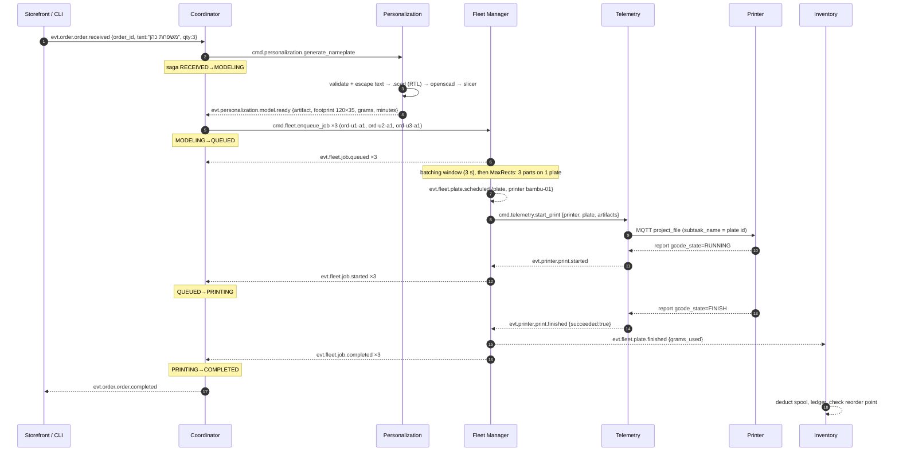

# 04 · Workflows

All flows below are implemented. Flows 1-3 are exercised by `tests/test_e2e.py` against real NATS + Postgres and simulated printers.

## 1. Nameplate order → printed (happy path)



## 2. Print failure → automatic safety stop

```mermaid
sequenceDiagram
  autonumber
  participant PR as Printer (Moonraker)
  participant TE as Telemetry
  participant CO as Coordinator
  participant H as Human

  loop every status update (~0.5 s)
    PR-->>TE: notify_status_update {extruder.temperature …}
    TE->>TE: PrinterState → detectors
  end
  Note over TE: nozzle more than 15 °C off target for ≥ 10 s → CRITICAL
  TE->>PR: printer.print.pause (hot path; no DB, no LLM)
  TE-->>CO: evt.printer.failure.detected {detector: thermal_runaway_nozzle, action_taken: paused}
  Note over CO: phase 3: approval "printer.cancel" with camera snapshot
  H->>CO: decide: cancel or resume
```

If the operator cancels, the printer reports `cancelled`/`FAILED`. Telemetry emits `print.finished(succeeded=false, progress=p)`. Fleet
marks the jobs failed and Inventory deducts `p × estimated grams`. The saga re-enqueues each unit (attempt 2) or escalates after
`MAX_PRINT_ATTEMPTS`.

## 3. Low stock → approval-gated reorder

```mermaid
sequenceDiagram
  autonumber
  participant FM as Fleet
  participant IN as Inventory
  participant CO as Coordinator
  participant H as Owner (CLI)

  FM-->>IN: evt.fleet.plate.finished {PLA black, 3 × 9.3 g = 27.9 g}
  IN->>IN: spool 650 → 622.1 g; on hand 622.1 < ROP 1200
  IN-->>CO: evt.inventory.stock.low
  alt cost ≤ auto_approve_limit
    IN-->>IN: PO placed → evt.inventory.reorder.placed
  else cost > limit (3 spools, 66.00)
    IN-->>CO: evt.approval.request.created {action: inventory.reorder}
    H->>CO: printfarm approve apr-… → cmd.coordinator.decide_approval
    CO-->>IN: evt.approval.request.decided {approved: true}
    IN-->>IN: PO placed → evt.inventory.reorder.placed → supplier (MCP tool)
  end
```

## 4. Social lead → human-approved reply (phase 3)

```mermaid
sequenceDiagram
  autonumber
  participant M as Group member (extension)
  participant SL as Social Listening (LLM)
  participant CO as Coordinator
  participant H as Owner

  M->>SL: cmd.social.ingest_capture {group, url, text}
  SL->>SL: LLM intent classification (structured output) + vector de-dup
  SL-->>CO: evt.social.lead.detected {intent 0.86, "nameplate for new home"}
  SL-->>CO: evt.social.reply.drafted + evt.approval.request.created {action: social.reply}
  H->>CO: approve (optionally after editing the text)
  CO-->>SL: evt.approval.request.decided
  Note over H: the human posts the reply in the group; the agent never posts
  H->>CO: order created from lead → evt.order.order.received (correlation = lead id)
```

## 5. Trend signal → operations (phase 3)

The Trend Analyst runs weekly, holding a KV lease so only one instance runs. It emits `evt.trend.signal.detected {topic: "PLA white",
direction: rising}`. Inventory raises `baseline_daily_grams` for that colour, which moves its reorder point. Personalization receives
template suggestions, and a human reviews them before they go live.
