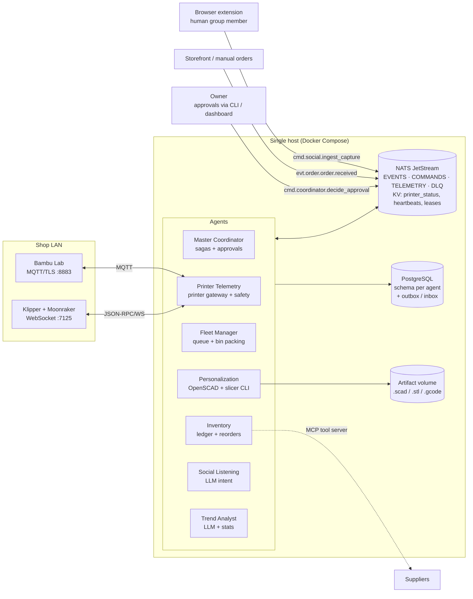

# Architecture: PrintFarm multi-agent orchestration platform

| Doc | Contents |
|---|---|
| **This page** | Goals, constraints, system overview, design principles |
| [01-agent-catalog.md](01-agent-catalog.md) | Every agent: responsibility, inputs/outputs, owned state, failure modes |
| [02-communication-protocol.md](02-communication-protocol.md) | Envelope, subjects, delivery guarantees, retries, DLQ, versioning |
| [03-state-management.md](03-state-management.md) | Data ownership, outbox/inbox, sagas, KV, consistency model |
| [04-workflows.md](04-workflows.md) | Sequence diagrams of the main business flows |
| [05-deployment-and-ops.md](05-deployment-and-ops.md) | Single-host deployment, security, observability, backups, scaling path |
| [adr/](adr/) | Architecture decision records |

Code lives in `src/printfarm/`; message contracts in `src/printfarm/contracts/`.

---

## 1. Context and constraints

* **Scale (year 1):** 3-5 printers (Bambu Lab + Klipper/Moonraker), 20-50 orders/day.
* **Hosting:** one machine (a strong VPS or a mini-PC on the shop LAN) running Docker Compose. No Kubernetes.
* **Main product:** personalised items (nameplates first), produced headlessly from the customer's text.
* **Compliance:** Meta removed the Groups API from the Graph API in 2024 and automated scraping breaks Meta's terms, so social listening
  ingests **only posts captured by a human group member** (browser extension) plus public sources the business may legally monitor.
  **Every outbound reply is approved by a human.**
* **Safety:** a detected printer failure must stop the printer within about one telemetry sample (≤ 1 s), even with the internet down.

## 2. System overview

## 3. Design principles

1. **Deterministic where it matters, LLM where it helps.** Telemetry, Fleet, Inventory and Personalization are plain Python with
   predictable behaviour and unit tests. LLM reasoning is used only for unstructured text: classifying buying intent, drafting replies,
   summarising trends, and handling free-form requests at the Coordinator. **No LLM call sits on the printer-safety path.**
2. **Orchestrate business workflows, choreograph everything else.** The Coordinator owns the *order saga*: it decides the next step for
   each order. Agents publish domain facts on the bus directly, without routing through the Coordinator, so it is never a bottleneck or
   a single point of failure for telemetry.
3. **Each agent owns its data.** One Postgres schema per agent. Other agents learn about changes only through events, never by reading
   another agent's tables.
4. **Effectively-once processing.** JetStream gives at-least-once delivery. Combined with the transactional outbox, inbox
   de-duplication and deterministic ids for events derived from observed state, every business effect happens exactly once.
5. **Humans gate irreversible or external actions.** Supplier orders above a limit, social replies, and cancelling a paused print all go
   through `ApprovalRequested` → human → `DecideApproval` → `ApprovalDecided`.
6. **Boring infrastructure, upgrade paths written down.** NATS + Postgres + Compose run comfortably on one box at this scale. The ADRs
   name the trigger for each upgrade: Temporal, OR-Tools CP-SAT, S3/MinIO, a second host.

## 4. Implementation status

| Component | Status |
|---|---|
| Contracts (CloudEvents envelope, 30+ typed messages, registry) | ✅ implemented + tested |
| Bus (NATS JetStream streams, durable consumers, DLQ, KV, request/reply) | ✅ implemented + e2e tested |
| State (migrations, outbox relay, inbox) | ✅ implemented + e2e tested |
| Master Coordinator (order saga, approval register) | ✅ implemented + tested |
| Printer Telemetry (Bambu MQTT + Moonraker WS adapters, detectors, auto-pause) | ✅ implemented + e2e tested against simulators |
| Fleet Manager (MaxRects packing, greedy assignment, batching window) | ✅ implemented + tested |
| Inventory (ledger, reorder policy, approval-gated POs, availability query) | ✅ implemented + tested |
| Personalization (Hebrew/RTL nameplates, OpenSCAD + slicer CLI hooks) | ✅ implemented; STL/G-code only when the tools are installed |
| Printer simulator (Bambu over MQTT, Moonraker over WebSocket, fault injection) | ✅ implemented |
| File upload to real printers (Bambu FTPS, Moonraker HTTP), multi-part plate compositing | ⏳ next: interfaces defined |
| Social Listening, Trend Analyst (LLM agents) | ⏳ contracts + schema defined; agents are phase 3 |
| Dashboard UI | ⏳ the CLI covers operations for now |
